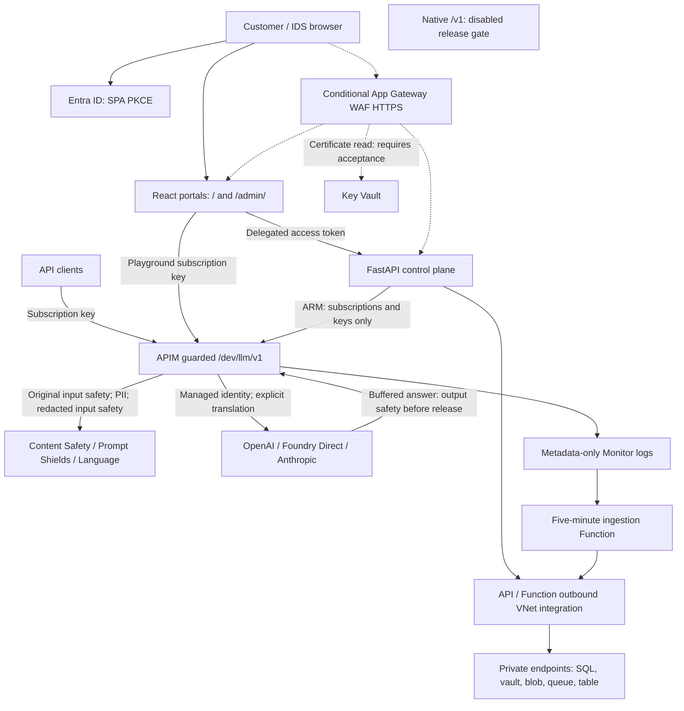

# AIFLUX - Access AI, Intelligently routed

An Azure API Management AI gateway with a tenant-isolated customer/IDS control
plane. Inference goes directly through APIM, not through the control-plane API.

## Public examples and deployment inputs

Deployment identifiers in this public snapshot are placeholders, not working
configuration. The all-zero subscription ID, synthetic tenant/operator/application
UUIDs, `aiflux-example*` resource names and endpoints, `operator@example.com`, and
documentation address `203.0.113.10` must be replaced with reviewed values in
ignored local inputs before any operator command is used. Pass the actual tenant,
bootstrap object ID, prefix and hostname explicitly to the Entra bootstrap tool.
Azure built-in role IDs and service authentication audiences are not placeholders.
The deferred operator's GitHub OIDC subject also requires replacing
`REPLACE_WITH_GITHUB_OWNER/REPLACE_WITH_REPOSITORY` with the approved repository.

Historical runbook observations do not validate these substituted example values.
Private source-repository links are omitted; local credentials, deployment
evidence, state, plans and generated artifacts are not part of this snapshot.
Private `*.tfvars.json` inputs are excluded from Git and container build contexts;
sanitized `*.tfvars.json.example` files may be tracked as examples.

**Production/native inference remains gated.** The separately configured guarded
development adapter is an ordinary HTTP API with explicit provider translation,
not proof of native unified-model preview support. Documentation records repository
behavior and historical acceptance; it does not certify current Azure state.
The [capability matrix](docs/capabilities.md) is the canonical status reference.

## Documentation

| Audience / question | Document |
| --- | --- |
| Product owners: business features, personas, user stories and acceptance | [PRD](docs/prd.md) |
| Engineers: components, interfaces, data flows and configuration | [Technical specification](docs/technical-specification.md) |
| Identity/platform/security reviewers: permissions, admin and CISO decisions | [Security and approvals readiness](docs/security-and-approvals.md) |
| Product/engineering: issue sequence and future improvements | [Roadmap](docs/roadmap.md) |
| Release reviewers: implemented, historically accepted, unverified and proposed | [Capabilities](docs/capabilities.md) |
| Portal developers | [Portals](docs/portals.md) |
| API, SQL and showback operators | [Control plane](docs/control-plane.md) |
| Gateway policy and validation operators | [Gateway](docs/gateway.md) |
| Customer pilot deployment | [Guided deployment and manual prerequisites](docs/deployment.md) |
| Development infrastructure operators | [Infrastructure](docs/infrastructure.md), [model deployment](infra/models/README.md) |
| Deferred alternative operator design | [Private operator](docs/operator-runner.md) |

IDS administrators can configure guarded-API safety thresholds, RPM/TPM and
explicit token quotas from `/admin/settings` after an operator opts in.
Versioned SQL history, conditional APIM fragment publication and retry keep
desired versus published state explicit; publication is not live enforcement
proof. Existing deployments remain unchanged by default. See the
[settings contract](docs/control-plane.md#admin-managed-gateway-settings) and
[operator rollout](docs/infrastructure.md#opt-in-admin-gateway-settings).

## Architecture

Solid arrows show implemented integration contracts, not verified running
resources. Dashed arrows are conditional target edge paths requiring acceptance.
The hybrid data path is conditional on reviewed Terraform inputs. Subnet ranges
come from `network` inputs; they are not fixed customer defaults.



The editable [Draw.io diagram](docs/architecture.drawio) uses the same boundary:
conditional edge paths do not establish TLS, WAF or origin-protection acceptance.
Terraform declares Key Vault `bypass = "AzureServices"` in
`infra\terraform\main.tf`; Function storage's `bypass = "None"` is a different
setting in `data.tf`. Neither declaration proves certificate retrieval succeeds.

## Development scope and limitations

The accepted-development catalog in source contains eleven enabled aliases.
Historical records describe guarded completions and a basic signed-in customer
journey. The adapter rejects streaming, tools and structured output. It uses
managed identity for provider calls, mandatory input/output checks and bounded
retry; it does not execute tools or store conversations.

Production/native `/v1` remains disabled. Native bearer subscription auth,
streaming safety, complete failover and final edge acceptance are separate gates.
Shared model pools can cross regions; backend failover is not gateway-region DR.
Rate/token limits are best effort, not hard financial caps.

Showback uses configured public/list rates, not invoices or negotiated discounts.
Missing prices/usage remain Unknown, not zero. A historical three-model FinOps
workload reconciled successfully; the later recorded ingestion pause involves
unowned smoke-test usage. Do not infer current freshness from past acceptance.
See [status and provenance](docs/capabilities.md).

## Local development

From the repository root in PowerShell:

```powershell
python -m venv .venv
.\.venv\Scripts\python.exe -m pip install -e ".[dev]"
.\.venv\Scripts\pytest.exe -q tests\unit tests\contract
.\.venv\Scripts\ruff.exe check services\control-plane\src tests\unit
.\.venv\Scripts\mypy.exe
npm ci
npm run typecheck
npm test
npm run build
```

See the linked runbooks for authentication, migration and configuration
prerequisites. CI validates without provisioning Azure. Deployment requires
separate cost/configuration approval; private SQL migrations and vault uploads
need an approved reachable operator path, not a public firewall exception.
Do not change shared Azure CLI defaults, apply example inputs as approvals,
or treat a green build as customer security sign-off.
