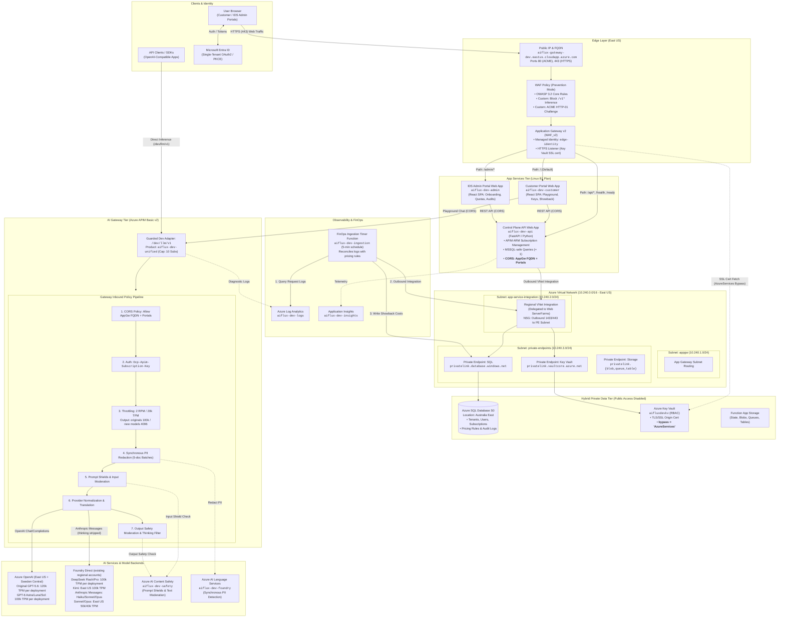
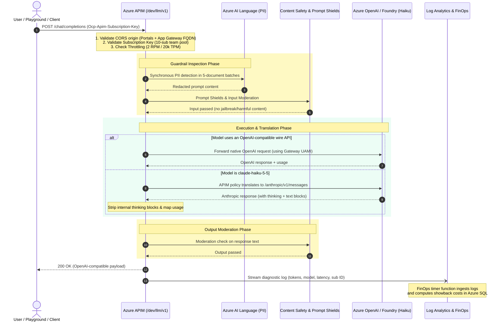

# AIFLUX - Access AI, Intelligently routed

An Azure API Management AI gateway and tenant-isolated customer/IDS control plane.

**Deployment is gated, not ready by default.** Native unified-model APIs are
preview/rollout-dependent. No model is exposed until the chosen APIM SKU,
provider translation, PII/safety behavior, and regional access are validated.
Tools and structured outputs cannot be advertised without inspection coverage.

## Components

| Component | Implementation |
| --- | --- |
| Public inference | APIM-only OpenAI-compatible `/v1/models` and `/v1/chat/completions` |
| Edge | Staged public Application Gateway WAF_v2 HTTPS -> public Basic v2 APIM/authenticated origins (no development Front Door) |
| Customer portal | React/TypeScript, Entra login, team keys, catalog, playground, showback |
| IDS portal | React/TypeScript, onboarding, organization/subscription showback, safety events |
| Control plane | Python FastAPI, APIM ARM operations, approved tenant/user authorization |
| Data | Azure SQL ownership, prices, usage projections, audit and safety metadata |
| Observability | Azure Monitor/Log Analytics and Python timer ingestion |
| Infrastructure | Terraform with AzureRM and narrowly scoped AzAPI resources |

The approved first-release design uses shared global model pools, approximate
round-robin routing, Retry-After-aware failover, best-effort RPM/token limits, and
estimated showback rather than invoice-grade chargeback.

Input PII is redacted with Azure Language. Content Safety and Prompt Shields
inspect input; output moderation uses sliding windows for SSE. A safety violation
may terminate a stream after earlier windows were delivered. No tool is executed
by the gateway or playground, and no prompts/completions are retained.

## Architecture

The diagrams below illustrate the system topology and traffic flows reflecting all current development and infrastructure changes:
- **Application Gateway v2 HTTPS & Key Vault integration:** Key Vault network ACLs permit `bypass = "AzureServices"` so Application Gateway v2 can retrieve and reload its SSL certificate via its User-Assigned Managed Identity (`edge-identity`).
- **Unified CORS coverage:** Application Gateway FQDN (`https://aiflux-gateway-dev.eastus.cloudapp.azure.com`) is configured as an allowed CORS origin across both the Control Plane API and the APIM guarded adapter.
- **Guarded `/dev/llm/v1` adapter:** Eleven accepted models: the original `gpt-5.6-luna`, `gpt-5.6-sol`, and `claude-haiku-5-5`, plus `gpt-6-astra`, `gpt-6-luna`, `gpt-6-sol`, `Kimi-K2.6`, `DeepSeek-V4-Flash-0731`, `DeepSeek-V4-Pro`, `claude-sonnet-5-5`, and `claude-opus-5-5`. Guarded non-streaming text chat retains thinking-block normalization, the 20,000 TPM per-subscription/model limit, and 10 team subscriptions. New models have a 4,096-token request output ceiling; original limits are unchanged.
- **Playground and showback:** Configured base/REST endpoint details and secret-free cURL/OpenAI Python examples; synchronized, zoomable minute charts for requests, reported tokens, and average latency. Usage-page latency is displayed in seconds; existing millisecond API/CSV fields remain unchanged.
- **Hybrid private data path:** Azure SQL (Australia East S0), Azure Key Vault, and Function Storage run with public access disabled via Private Endpoints in VNet `10.240.3.0/24`. Outbound access from App Service uses regional VNet integration (`10.240.2.0/24`).

An editable Draw.io version is also maintained at [`docs/architecture.drawio`](docs/architecture.drawio).

### System Topology & Routing



### Gateway Request & Guardrails Flow



## Deployment context

The user-selected FDPO subscription is `4d75ed7f-75ab-4db6-b1f3-263f240d1450`.
Resource group **`rg-aiflux-fdpo-dev`** has been created and verified in **East US**.
This is the group's metadata location, not proof of model/SKU availability.
All scripts must select this subscription explicitly; do not change shared CLI
defaults. Existing resource groups and workloads must not be modified.

Development uses Basic v2 APIM, public B1 apps/Foundry endpoints and private SQL S0
in Australia East. SQL, Key Vault and Function storage have private endpoints;
API/ingestion use outbound VNet integration. Single-tenant Entra registrations,
application images and SQL migration/bootstrap are deployed.
Deploy locally with Azure CLI/Entra authentication and encrypted, access-controlled
ignored local Terraform state. No VM/private runner/operator or blob-state bootstrap
is required. Private operator/state designs are deferred. Examples remain unapproved
and provision nothing.

Guarded Luna/Sol text completions have succeeded through
`https://aiflux-fdpo-dev-apim.azure-api.net/dev/v1` with an approved APIM subscription
key. This separate limited dev product is not the final native unified API: streaming,
tools and structured outputs are rejected. The main `/v1` route remains denied and
ingestion remains disabled. Haiku 5.5 is deployed in both model regions but is not
routed by this original development API. Basic customer acceptance is recorded
below; full admin/multi-tenant journeys, failover/quota/safety and live FinOps remain pending.

**Latest development path (2026-10-14):** the user-approved, Terraform-managed
text adapter at `https://aiflux-fdpo-dev-apim.azure-api.net/dev/llm/v1` returns
real OpenAI-shaped completions for all eleven accepted catalog models listed
above. This is explicit APIM policy translation, **not** the native
unified-model preview. Its separate `aiflux-dev-unified` product is used by the
control plane for new team keys. The original `/dev/v1` remains available for
its original approved subscriptions; `/v1` and the experimental `/llm/v1` remain
denied. Both providers retain original/redacted input safety, Prompt Shields,
five-document PII batches, output safety, UAMI authentication and bounded retry.
Streaming/tools/structured output are rejected. The user-approved adapter bounds
are 2 RPM/model/subscription and 20,000 TPM, with 100,000 completion tokens per
request for original models and 4,096 for the eight new aliases,
with a 240-second backend timeout. Legacy `/dev/v1` retains 2,048 TPM and 64 output
tokens. A live Sol request completed a 6,364-word essay with 8,571 completion tokens.
The Haiku response-conversion failure is repaired: validated internal thinking
blocks are omitted, full usage is retained, and final text must pass output
safety. Haiku completed a live 5,241-word essay with normal `stop`; malformed,
unknown or internal-only responses still fail closed. The ceiling does not
guarantee generation length or completion before a timeout.

Direct customer/admin App Service endpoints are intentionally public as the
approved stopgap; Entra and SQL membership authorization remain mandatory.
The portals use the direct API and APIM origins, with exact CORS/CSP settings,
native subscription-key headers and capability-aware non-streaming requests.
The development catalog contains eleven callable models, all checked before
publication. The API and enabled ingestion Function bundle the same accepted
catalog. Production inference remains disabled. New aliases do not inherit
prices from other models; unpriced usage remains Unknown.
The user confirmed the signed-in customer journey: team subscription
reconciliation succeeds, its key reveals, and both OpenAI and Anthropic respond
in the playground. The deployment-only blockers were SQL Server-invalid Boolean
approval predicates and the adapter product's one-subscription cap. Both are fixed;
the user-approved cap is 10, and disposable test subscriptions have been deleted.

Bounded dev acceptance now includes correct 401/400/415/429/403 status handling,
Luna/Sol inference, and a synthetic Prompt Shields rejection. RPM/TPM counters are separate;
2 RPM allowed three requests before throttling in one burst (best-effort overshoot of one).
Explicit metadata-only LLM diagnostics now correlate both fresh model completions with
subscription-owned gateway logs; body/message absence was checked after activation.
This is not full PII/failover/portal/FinOps acceptance or native bearer/Anthropic support.
The synchronous PII five-document limit is now respected while preserving the 25-message
API bound; 5/6/25-message role/Unicode cases pass. Buffered transient model 5xx gets one
bounded retry; unknown usage from prior attempts remains incomplete in FinOps.

**Basic development deployment accepted.** Remaining work: native unified API,
complete safety/failover acceptance and live FinOps. Application
Gateway HTTPS remains deferred. Its trusted certificate is
issued, but Key Vault certificate access blocks HTTPS; renewal is not automated.
Direct APIM managed HTTPS remains the dev inference path. Deferring the edge fix
does not waive final TLS/origin-protection acceptance.
See the [dev runbook](docs/infrastructure.md).

## Development

Python setup, authentication, migrations and ingestion:
[Control plane](docs/control-plane.md).
Frontend setup and tests: [Portals](docs/portals.md).
Gateway policy/provisioning: [Gateway](docs/gateway.md).
Azure configuration: [Infrastructure](docs/infrastructure.md).
Supported/native capability gates: [Capabilities](docs/capabilities.md).

```powershell
python -m venv .venv
.\.venv\Scripts\python.exe -m pip install -e ".[dev]"
.\.venv\Scripts\pytest.exe -q
.\.venv\Scripts\ruff.exe check services\control-plane\src tests\unit
.\.venv\Scripts\mypy.exe
npm ci
npm run typecheck
npm test
npm run build
```

CI validates Python, frontend builds and Terraform without provisioning Azure.
The old private-runner deployment workflow is disabled; use the reviewed local
operator route today. The approved hybrid root keeps SQL, vault and Function
storage public-disabled with private endpoints; API/ingestion integrate outbound.
Private SQL migrations/vault uploads require an approved VNet-connected execution
route, not a public firewall exception. See the infrastructure runbook.

## Native limitations

Per-request cached-read/cache-write tokens and true streaming time-to-first-token
are not available in the documented native LLM log schema. They are nullable and
explicitly marked unsupported unless native coverage is proven. Gateway total
latency is **not** a TTFT substitute. Missing prices/usage/backend attribution
cannot become zero-cost records.

There is one gateway region in this release; model-backend failover does not
provide gateway-region disaster recovery. Customers share a global backend pool:
cross-border processing must be disclosed during onboarding.

## Backlog

Resolve native unified-model routing/translation, replace the six
preview tiles with genuinely deployed/validated models, enable validated
FinOps ingestion, and fix Application Gateway certificate access/renewal.
Public App Service access is a development stopgap, not final edge acceptance.

Managed Redis semantic caching, customer-editable limits within IDS allocations,
and explicitly consented Cosmos DB subscription memory are not implemented in
the first release.

## References

- [Canonical APIM AI Gateway labs](https://github.com/Azure-Samples/AI-Gateway)
- [AI Hub Gateway accelerator](https://github.com/Azure-Samples/ai-hub-gateway-solution-accelerator)
- [Terraform landing-zone counterpart](https://github.com/Azure/terraform-ai-gateway-landing-zone)
- [Native unified model API](https://learn.microsoft.com/azure/api-management/unified-model-api)
